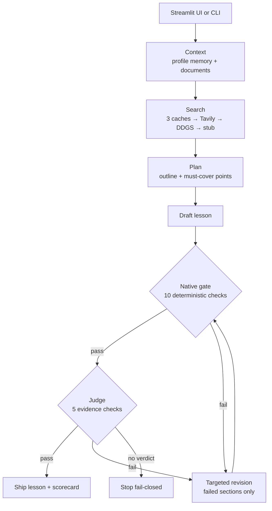
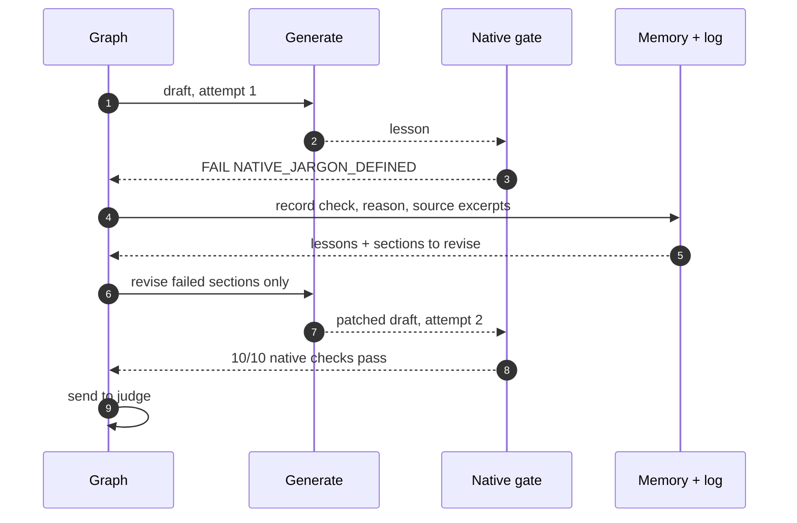
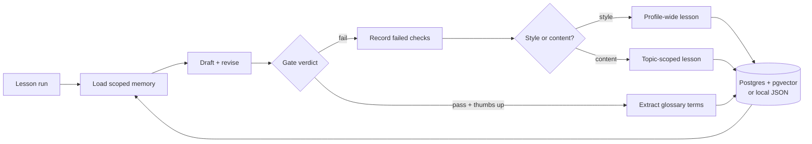

# Self-Evaluating Lesson Generator

**Most AI lesson generators ship the first draft. This one refuses to.**

A fail-closed LangGraph pipeline that plans, drafts, tests, repairs, and only then ships a beginner lesson. Every lesson passes **15 binary quality gates** before a learner ever sees it. If a gate cannot decide, the run stops instead of guessing.

The default learner is a 12th-grade graduate from India with limited English and a non-English-medium background. The pipeline is topic-agnostic: RAG, linear algebra, and UPI all use the same gates.

---

## Overview

**What does the system do?** Search, plan, draft, evaluate, repair. Every lesson clears two gates before it ships.



`source_pack` and `plan` are frozen before the first draft. A retry rewrites only the failed sections, against the same evidence. The plan cannot quietly change to make a check pass.

Full node flow and state boundaries: [docs/architecture.md](docs/architecture.md).

---

## The problem

A single LLM call produces text that looks finished but fails silently:

- It drifts above the learner's reading level.
- It invents facts that the sources never said.
- It drops required sections during a revision.
- It grades itself and passes.
- It hides failures behind a friendly paragraph.

This pipeline treats all five as stop-the-line defects.

---

## Impact at a glance

These are architectural guarantees and arithmetic bounds from the pipeline, not marketing telemetry.

| Impact | Mechanism | Number |
| --- | --- | --- |
| Paid judge calls avoided on formatting defects | Native gate runs first; a native failure skips the judge entirely | **100%** of native-rejected drafts |
| Zero-cost quality checks | 10 of 15 gates are deterministic Python, no tokens | **$0** per native check |
| Revision cost cut | Only failed sections are rewritten; math assumes 4 planned sections | **up to 75%** less rewritten text when 1 of 4 sections fails |
| Runaway spend eliminated | `MAX_ATTEMPTS` is a hard cap on drafts and revisions | **3 attempts total: 1 draft + 2 revisions max** |
| Judge evidence cannot be faked | Quotes must be verbatim substrings of the lesson or sources; one repair, then fail closed | **100%** of non-verbatim evidence rejected |
| Repeat planning is free | Deterministic cache keyed on topic, sources, profile, prompt, and hints | **0 model calls** on a warm plan |
| Database self-heals | Disabled pool is re-probed instead of cached until restart | **every 30s** |
| Search survives outages | 3 cache layers, 2 live backends, then an offline stub that cannot pass grounding | **6 fallback stages** |
| Prompt stays focused | Profile-scoped memory injects only the most relevant context | **≤10 glossary terms + ≤3 failure notes** |
| Regressions caught before merge | Mocked unit and graph tests, no live API required | **66 tests, 0 network calls** |

---

## Technology choices: why each one earned its place

| Technology | Role | Why we used it | Production impact |
| --- | --- | --- | --- |
| **LangGraph** | Explicit state machine for plan, draft, evaluate, revise, stop | Retry limits and failure paths are first-class edges, not `while` loops buried in application code | Stop paths are reviewable; a failed run cannot loop forever |
| **Pydantic v2** | Typed contracts for profiles, plans, drafts, judge results | Malformed model output fails at the boundary instead of leaking into business logic | Validation errors are caught before a single gate runs |
| **OpenAI-compatible provider layer** | One interface for NVIDIA, OpenRouter, and compatible endpoints | Model IDs live in `.env`, never in code; swapping providers is configuration | No vendor lock-in; judge and draft can use different models |
| **textstat** | Flesch Reading Ease, grade level, rare-word ratio | Readability is measured, not vibes | Catches lessons written above the learner's grade level |
| **Tavily + DuckDuckGo** | Grounded source retrieval | Two independent backends before an offline stub | A dead API degrades; it does not silently invent sources |
| **Streamlit** | Operator UI | Profile, session, scorecard, rejection log, and audit events in one place | Reviewers can inspect *why* a lesson passed or failed |
| **Postgres + pgvector** | Relational and semantic persistence | Similarity search for memory and uploaded documents | One query path for structured state and vector recall |
| **psycopg_pool** | Connection pooling | Avoids a new connection per request | Predictable latency under concurrent UI sessions |
| **LangSmith** | Optional tracing | Full prompt and response visibility during debugging | Failures are diagnosable without reproducing them |
| **PyYAML** | Rubric, jargon, and topic hints | Quality policy is data, not code | A reviewer can audit the rules without reading Python |
| **pypdf** | Document ingestion | Learners can ground lessons in their own PDFs | Real course material becomes source context |
| **JSONL audit** | Per-run event log | Append-only, survives Postgres outages | Every model call is reconstructable after the fact |
| **pytest** | Test suite | Model calls are mocked at the boundary | CI runs in seconds, with no API keys |

---

## The 15-gate quality system

**What are the pass/fail checks?** Fifteen binary gates, split by cost.

Tier 1 runs first and costs no tokens. A native failure skips the judge. Tier 2 runs only after native passes, and every verdict must carry verbatim evidence.

| Tier | Gate | Pass condition | Cost |
| --- | --- | --- | --- |
| 1 | `NATIVE_READABILITY` | Flesch Reading Ease ≥ 60, grade level ≤ 8.5 | Free |
| 1 | `NATIVE_SENTENCE_LEN` | Average ≤ 16 words, no sentence > 25 | Free |
| 1 | `NATIVE_REQUIRED_SECTIONS` | Every planned `##` heading exists, in order | Free |
| 1 | `NATIVE_ORDERED_STEPS` | Process section has ≥ 3 numbered or ordinal steps | Free |
| 1 | `NATIVE_EXAMPLE_HAS_NUMBERS` | Practical example contains a concrete number | Free |
| 1 | `NATIVE_JARGON_DEFINED` | Each technical term is defined on first use | Free |
| 1 | `NATIVE_KNOWN_FALSE_CLAIMS` | Configured false claims never appear | Free |
| 1 | `NATIVE_CITATION_GROUNDING` | Cited URLs exist in the active source pack | Free |
| 1 | `NATIVE_SOURCE_GROUNDING` | The run is backed by real sources, not the offline stub | Free |
| 1 | `NATIVE_RARE_WORD_RATIO` | Difficult-word ratio stays under the configured ceiling | Free |
| 2 | `JUDGE_ACCURACY_GROUNDING` | Claims are true and do not contradict sources | 1 judge call |
| 2 | `JUDGE_AUDIENCE_FIT` | Language matches the exact learner profile | 1 judge call |
| 2 | `JUDGE_TEACH_BY_EXAMPLE` | One traceable worked example exists | 1 judge call |
| 2 | `JUDGE_KEY_POINTS_COVERAGE` | Every planned must-cover point is present by meaning | 1 judge call |
| 2 | `JUDGE_COHERENT_FLOW` | Introduction → explanation → takeaway | 1 judge call |

All five judge checks arrive in a single structured response, so a run that reaches tier 2 costs one judge call, not five.

### Fail-closed by design

- Every `evidence_quote` must be a verbatim substring of the lesson, whitespace-normalized.
- Every accuracy failure must quote a verbatim source line.
- One repair call is allowed. If evidence still does not match, the result is a **judge error**, not a lesson failure, and the run stops.
- A missing judge check is a conservative failure marked as an evaluator error. The router never treats it as lesson feedback.

A judge that cannot prove its verdict does not get a vote.

---

## One failing run and the rejection log

**How does it regenerate, and what is logged?** This is the common case: the draft is structurally sound but a term is undefined. The run never reaches the judge, and the retry rewrites only what failed.



Every retry writes one `rejection_log` entry before the next draft starts:

| Field | What it holds | Why a reviewer cares |
| --- | --- | --- |
| `stage_failed` | `native` or `judge` | Shows which tier caught the defect |
| `failed_check_ids` | Exact gate IDs | Reproducible, not a prose complaint |
| `reasons` | Gate messages and violations | Explains the failure without re-running it |
| `revised_sections` | Section headings sent back | Proves the retry was targeted, not a full rewrite |
| `source_evidence` | Up to three source excerpts | Shows what the model was allowed to claim |
| `revision_diff` | Unified diff of the draft before and after the retry | Proves what actually changed between attempts |

The same entry feeds short-term memory, so the next attempt starts from what failed instead of rediscovering it. The Streamlit rejection tab renders these entries beside the scorecard, so a reviewer can read the failure without opening a log file.

---

## Features and why they exist

| Feature | Why it matters |
| --- | --- |
| **Two-tier evaluation** | Cheap checks absorb mechanical defects; the expensive judge only reviews meaning |
| **Targeted revision** | Rewrites only failed sections, so a passing section cannot regress |
| **Bounded retries** | `MAX_ATTEMPTS=3` caps latency and spend; no infinite self-repair loop |
| **Frozen plan and sources** | A retry cannot move the goalposts or swap evidence |
| **Topic hints** | Domain facts live in `data/topic_hints/`, loaded only when the topic matches |
| **Profile-scoped memory** | Style lessons apply across topics; content lessons stay topic-specific |
| **Profile migration** | Old default cultural context upgrades on load; custom values are never touched |
| **Numeric worked examples** | Beginners need one concrete number, not another abstract definition |
| **Document knowledge library** | TXT, Markdown, HTML, and PDF become searchable source context |
| **Rejection log with diffs** | Every retry records failed check IDs, reasons, source excerpts, and a unified diff |
| **Audit trail** | Every provider call logs stage, model, attempt, latency, tokens, finish reason, and error class |
| **Offline fallback** | Search and Postgres can fail; the pipeline reports it and never ships ungrounded content |

---

## Memory: how it learns across runs

**How does it learn across runs?** Memory is not a chat history. It is a small, scoped store: read before drafting, updated when a gate fails, and promoted only after a human approves.



Three rules keep memory from becoming noise:

1. **Style failures go profile-wide; content failures stay topic-scoped.** A readability failure on RAG teaches the next lesson on UPI. A wrong UPI fact does not contaminate a tensor lesson.
2. **Retrieval is thresholded, not exhaustive.** Related memory is injected only above a cosine similarity of `0.60`, capped at 10 glossary terms and 3 failure lessons, so the prompt stays focused as history grows.
3. **Only successful, human-approved lessons donate glossary terms.** A thumbs-up promotes the lesson and up to two glossary terms; a thumbs-down records a short reason and teaches nothing.

The loop is deliberately asymmetric: a failure is recorded immediately and used on the next attempt, while a success is only promoted after human approval. Bad lessons cannot teach the system; good ones can.

---

## Architecture decisions and trade-offs

| Decision | Reason | Trade-off we accept |
| --- | --- | --- |
| LangGraph over a function chain | Retry and stop paths are explicit | More setup than a linear script |
| Native checks before the judge | Deterministic checks are free and reproducible | Mechanical checks cannot judge meaning |
| Fixed rubric in `rubric.yaml` | Pass criteria stay stable across topics and retries | Topic-specific depth comes from the plan, not the rubric |
| Three total attempts | One draft plus two targeted revisions | Some lessons still stop failed |
| Optional embeddings | Memory is injected only above a calibrated cosine threshold | Similarity is approximate until calibrated |
| Postgres/pgvector plus JSON fallback | Semantic features when available, offline-friendly otherwise | Local JSON is single-process storage |
| Separate draft and judge models | Independent review is stronger | A single-model provider turns this into self-grading, and the UI warns |

---

## Quickstart

Requires Python 3.10+.

```bash
python -m venv .venv
source .venv/bin/activate
python -m pip install --upgrade pip
pip install -r requirements.txt
cp .env.example .env
```

Set at least:

```bash
LLM_PROVIDER=nvidia
NVIDIA_BASE_URL=https://integrate.api.nvidia.com/v1
NVIDIA_API_KEY=...
NVIDIA_MODEL=...
DRAFT_MODEL=...
JUDGE_MODEL=...
```

`PLAN_MODEL` is optional and defaults to the draft model. Tavily and embedding credentials are optional.

### Optional Postgres/pgvector

```bash
docker compose --profile full up -d postgres
```

Set `DATABASE_URL` in `.env`. Compose applies `db/schema.sql` on a fresh volume. If Postgres is down, the app uses local JSON/JSONL and keeps working.

### Verify every dependency

```bash
python scripts/healthcheck.py
```

Prints a separate PASS/FAIL for one model request, one Tavily request, one embedding request, and a Postgres write/read.

---

## Run

```bash
streamlit run app.py
```

Or one lesson from the terminal:

```bash
python scripts/run_lesson.py "Introduction to RAG"
python scripts/run_lesson.py "Introduction to RAG" --inject-error factual_jargon
python scripts/run_lesson.py "Introduction to RAG" --inject-error paraphrased_falsehood
```

`factual_jargon` proves the native gates catch a known false claim and an undefined term. `paraphrased_falsehood` proves the judge catches a reworded falsehood that substring matching cannot.

---

## Configuration that matters

| Variable | Default | Effect |
| --- | --- | --- |
| `MAX_ATTEMPTS` | `3` | Total drafts, including the first |
| `DB_RETRY_SECONDS` | `30` | Re-probe interval after a database failure |
| `SEMANTIC_SIMILARITY_THRESHOLD` | `0.60` | Minimum cosine similarity for memory retrieval |
| `LLM_TOP_P` | provider default | Sampling only; unrelated to memory selection |
| `PROMPT_SOURCE_COUNT` | see `.env.example` | Sources in the judge window before cited extras |
| `PLAN_MODEL` / `DRAFT_MODEL` / `JUDGE_MODEL` | see `.env` | Model routing per stage |

`MAX_ATTEMPTS` is the total number of attempts, not the number of retries. `3` means one initial draft and at most two revisions.

---

## Tests and verification

```bash
pytest -q
```

66 tests. Model calls are mocked; no API keys required.

End-to-end checklist for a live environment:

1. RAG lesson passes and thumbs-up persists.
2. Related memory is retrieved; unrelated memory is not.
3. Follow-up chat answers only from a shipped lesson.
4. Deliberate-error injection recovers on the next attempt.
5. Invalid search credentials fall back without shipping ungrounded content.
6. Postgres-down still generates and evaluates.
7. Empty or nonsense topics are rejected before a model call.

Do not treat a mocked test or a healthcheck failure as an end-to-end PASS.

### Threshold calibration

```bash
python scripts/calibrate_threshold.py
```

Computes precision and recall from real embeddings against `data/threshold_pairs.json`. Review the labeled pairs before changing the threshold.

---

## Observability

Every provider request records:

- stage, model, graph attempt, provider attempt
- latency, token usage, finish reason, HTTP status
- classified error

Run events append to `logs/run_<id>.jsonl` even when Postgres is unavailable. The rejection log adds failed check IDs, reasons, source excerpts, revised sections, and a unified diff.

If `JUDGE_MODEL` resolves to the same model as `DRAFT_MODEL`, the UI and run log warn that the review is not independent. That warning is deliberate: a self-grading system is a weaker signal, and the pipeline says so.

---

## Repository layout

```
src/
  graph.py            LangGraph wiring, retry router, scorecard
  schemas.py          Typed state and result contracts
  nodes/
    search.py         Cache → Tavily → DDGS → offline stub
    plan.py           Topic normalization, outline, topic hints
    generate.py       Drafting, targeted revision, format repair
    eval_native.py    10 deterministic gates
    eval_judge.py     5 LLM gates, evidence validation, fail-closed
  memory.py           Profile-scoped lessons and migration
  db.py               Postgres/pgvector with self-healing fallback
  llm.py              Provider wrapper, retries, audit hooks
prompts/              plan.md, generate.md, judge.md
rubric.yaml           Native check policy
jargon.yaml           Terms that must be defined on first use
data/topic_hints/     Domain facts loaded only for matching topics
scripts/              healthcheck, run_lesson, calibrate_threshold
tests/                66 mocked tests
docs/architecture.md  Node flow and state boundaries
```

---

## Reliability: what heals, what stops

**What happens when things break?** The pipeline degrades in only two directions: it falls back to a weaker component, or it stops. It never guesses.

| Failure | Detection | Automatic response | Invariant |
| --- | --- | --- | --- |
| Postgres unreachable | Pool acquisition fails | Disable the pool, use local JSON/JSONL, re-probe every `DB_RETRY_SECONDS` (30s) | Generation and evaluation keep working |
| Postgres driver missing | Import error at startup | Same local fallback; slower 60s re-probe | A missing dependency is not a crash |
| Search backend down | Empty result or provider error | Advance caches → Tavily → DDGS → offline stub (6 stages) | The stub cannot pass `NATIVE_SOURCE_GROUNDING` |
| Provider timeout or rate limit | Classified HTTP/timeout error | Retry the call once with backoff, then raise a typed error | A partial draft is never evaluated or shipped |
| Malformed model JSON | Schema validation fails | One lightweight repair call, then a typed failure | Bad output cannot enter business logic |
| Judge evidence not verbatim | Substring check fails | One repair call; if still wrong, mark judge error and stop | A verdict without proof is discarded |
| Judge omits a check | Result set incomplete | Treat it as an evaluator error, not lesson feedback | Missing evidence never triggers a content rewrite |
| Revision drops a section | `NATIVE_REQUIRED_SECTIONS` fails | Send the missing headings back, bounded by `MAX_ATTEMPTS=3` | A retry cannot silently shrink the lesson |
| Embedding service unavailable | No vector returned | Skip semantic memory for this run, continue with profile memory | Memory is an optimization, not a dependency |
| Draft and judge share a model | Model ID comparison | UI and run log warn that review is not independent | Self-grading is disclosed, never hidden |

---

## Limits

- A shared draft and judge model is not an independent review. The code warns; it cannot manufacture a second model.
- The free endpoint may rate-limit or change availability. Provider failures are reported, and incomplete drafts are never evaluated.
- Local JSON fallback is single-process storage. Production needs transactional Postgres and managed quotas.
- When every search backend fails, the offline stub is allowed to draft but `NATIVE_SOURCE_GROUNDING` fails closed. No ungrounded run can pass.
- The judge is probabilistic. Verbatim-evidence validation and conservative missing-check handling reduce the blast radius; they do not make it deterministic.

---

## The point

Quality is not a prompt. It is a pipeline with gates, evidence, bounded retries, and a refusal to ship when the system cannot prove the lesson is good.

That is the difference between a demo and something you can put in front of a learner.
