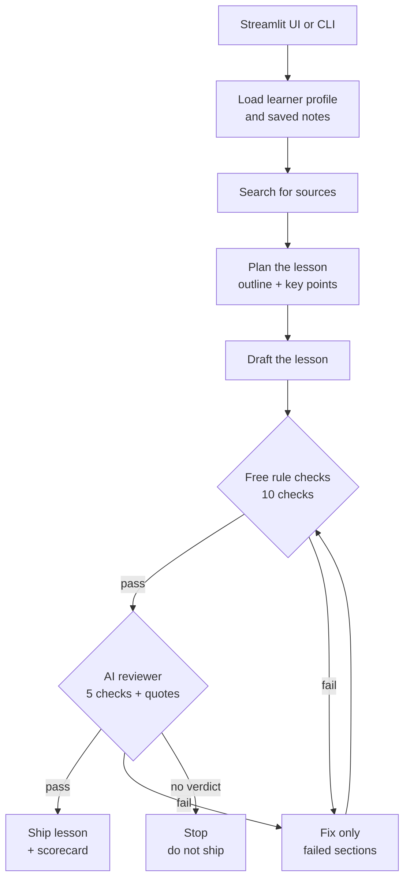
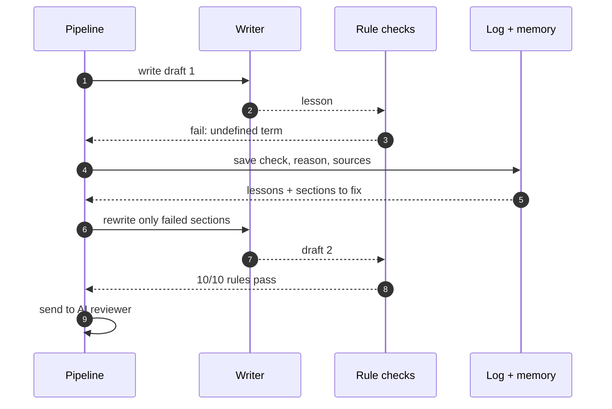
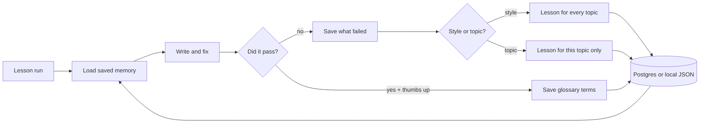

# Vidya Loop

**Most AI lesson generators ship the first draft. This one refuses to.**

Vidya Loop writes a beginner lesson. It checks the lesson against **15 pass/fail rules**. It fixes only what failed. It ships only when every rule passes. If a checker cannot prove its answer, the run stops instead of guessing.

---

## Details

### What it is

Vidya Loop is a self-evaluating lesson generator. It searches for real sources and plans the lesson. Then it writes a draft, tests it, and repairs the failed parts. Only then does a learner see the lesson.

The default learner is a 12th-grade graduate from India. This learner has limited English and a non-English-medium background. The pipeline is topic-agnostic: RAG, linear algebra, and UPI all use the same rules.

### The problem

One LLM call produces text that looks finished but fails silently:

- It drifts above the learner's reading level.
- It invents facts the sources never said.
- It drops required sections during a revision.
- It grades itself and passes.
- It hides failures behind a friendly paragraph.

This pipeline treats all five as stop-the-line defects.

### What you get

These are guarantees built into the pipeline, plus arithmetic bounds. They are not measured production telemetry.

| Guarantee | How it works | Number |
| --- | --- | --- |
| Formatting mistakes never reach the paid reviewer | The 10 free checks run first. A failure skips the AI reviewer | **100%** of drafts rejected by free checks |
| Most quality checks cost nothing | 10 of the 15 checks are plain Python | **$0** per free check |
| Revisions stay small | Only failed sections are rewritten. Assumes 4 planned sections | **up to 75%** less rewritten text when 1 of 4 sections fails |
| Spending cannot run away | `MAX_ATTEMPTS` caps drafts and fixes | **3 attempts total: 1 draft + 2 fixes** |
| The reviewer cannot make up evidence | Every quote must appear word-for-word in the lesson or a source | **100%** of non-matching quotes rejected |
| Repeat planning is free | A cache keyed on topic, sources, profile, prompt, and hints | **0 model calls** on a warm plan |
| The database recovers by itself | A disabled connection pool is re-tested instead of staying dead until restart | **every 30s** |
| Search survives outages | 3 cache layers, 2 live search backends, then an offline stub | **6 fallback stages** |
| Prompts stay small | Memory is filtered by relevance and capped | **≤10 glossary terms + ≤3 failure notes** |
| Regressions are caught before merge | Unit and graph tests mock every model call | **66 tests, 0 network calls** |

---

## Architecture

### End-to-end flow

**What does the system do?** Search, plan, draft, evaluate, repair. Every lesson clears two levels of checks before it ships.



In plain English:

1. **Find real sources.** The app tries its three cache layers first. Then it tries Tavily, DuckDuckGo, and an offline stub.
2. **Plan before writing.** The plan lists the sections and the key points the lesson must cover.
3. **Draft the lesson.** A model writes the first version.
4. **Run the free checks.** Ten Python checks catch mechanical problems. They use no AI call and cost nothing.
5. **Run the AI reviewer.** This step runs only if the free checks pass. A second model then judges meaning, accuracy, and audience fit.
6. **Fix only what failed.** The failed sections are rewritten, not the whole lesson.
7. **Ship or stop.** Three attempts maximum, then the run fails visibly.

The plan and the sources are frozen before drafting. A retry cannot move the goalposts or swap evidence to make a check pass.

Full node flow and state boundaries: [docs/architecture.md](docs/architecture.md).

### The 15 checks

**What are the pass/fail checks?** Fifteen binary checks, split by cost.

Level 1 is free and runs first. Level 2 costs one AI call and runs only after level 1 passes. Every level-2 verdict must include exact quotes as evidence.

| Level | Check | Passes when | Cost |
| --- | --- | --- | --- |
| 1 | `NATIVE_READABILITY` | Flesch Reading Ease ≥ 60; grade level ≤ 8.5 (plain-English score) | Free |
| 1 | `NATIVE_SENTENCE_LEN` | Average sentence ≤ 16 words; no sentence over 25 | Free |
| 1 | `NATIVE_REQUIRED_SECTIONS` | Every planned section heading exists, in order | Free |
| 1 | `NATIVE_ORDERED_STEPS` | The process section has at least 3 numbered steps | Free |
| 1 | `NATIVE_EXAMPLE_HAS_NUMBERS` | The practical example contains a real number | Free |
| 1 | `NATIVE_JARGON_DEFINED` | Every technical term is defined on first use | Free |
| 1 | `NATIVE_KNOWN_FALSE_CLAIMS` | Configured false claims never appear | Free |
| 1 | `NATIVE_CITATION_GROUNDING` | Every cited URL exists in the active source pack | Free |
| 1 | `NATIVE_SOURCE_GROUNDING` | The run used real sources, not the offline stub | Free |
| 1 | `NATIVE_RARE_WORD_RATIO` | Difficult-word ratio stays under the configured limit | Free |
| 2 | `JUDGE_ACCURACY_GROUNDING` | Claims are true and do not contradict sources | 1 AI call |
| 2 | `JUDGE_AUDIENCE_FIT` | Language matches the exact learner profile | 1 AI call |
| 2 | `JUDGE_TEACH_BY_EXAMPLE` | One traceable worked example exists | 1 AI call |
| 2 | `JUDGE_KEY_POINTS_COVERAGE` | Every planned key point is present by meaning | 1 AI call |
| 2 | `JUDGE_COHERENT_FLOW` | Introduction → explanation → takeaway | 1 AI call |

All five level-2 checks come back in one structured response. Reaching level 2 costs one AI call, not five.

### Why it stops instead of guessing

The pipeline is **fail-closed**. When it cannot prove a lesson is good, it does not ship.

- Every quoted piece of evidence must appear word-for-word in the lesson or a source.
- Every accuracy failure must quote a real source line.
- One repair call is allowed. If the quote still does not match, the result is a **judge error**. It is not a lesson failure, and the run stops.
- A missing review check is treated as an evaluator error. The retry logic never mistakes it for lesson feedback.

A reviewer that cannot prove its verdict does not get a vote.

### What happens when a lesson fails

**How does it regenerate, and what is logged?** This is the common case. The draft is structurally fine, but one term is undefined. The run never reaches the AI reviewer, and the retry rewrites only what failed.



The pipeline keeps a **rejection log**. It writes one structured entry for every retry, before the next draft starts.

| Field | What it holds | Why it matters |
| --- | --- | --- |
| `stage_failed` | `native` or `judge` | Shows which level caught the defect |
| `failed_check_ids` | Exact check IDs | Reproducible, not a prose complaint |
| `reasons` | Check messages and violations | Explains the failure without re-running it |
| `revised_sections` | Section headings sent back | Proves the retry was targeted, not a full rewrite |
| `source_evidence` | Up to three source excerpts | Shows what the model was allowed to claim |
| `revision_diff` | Diff of the draft before and after the retry | Proves what actually changed |

The same entry feeds short-term memory. So the next attempt starts from what failed. The Streamlit rejection tab shows these entries beside the scorecard. A reviewer can read the failure without opening a log file.

### Memory: how it improves over time

**How does it learn across runs?** Memory is not a chat history. It is a small, scoped store. It is read before drafting and updated when a check fails. It is promoted only after a human approves.



Three rules keep memory from becoming noise:

1. **Style failures go everywhere; content failures stay put.** A readability failure on RAG teaches the next lesson on UPI. A wrong UPI fact does not contaminate a tensor lesson.
2. **Only relevant memory is loaded.** Memory is injected only above a meaning-similarity score of `0.60`. It is capped at 10 glossary terms and 3 failure notes.
3. **Only approved lessons donate glossary terms.** A thumbs-up promotes the lesson and up to two glossary terms. A thumbs-down records a short reason and teaches nothing.

Failures teach immediately; successes must be approved. Bad lessons cannot teach the system; good ones can.

### Design choices and trade-offs

| Decision | Why | What we accept |
| --- | --- | --- |
| LangGraph instead of a function chain | Retry and stop paths are explicit | More setup than a linear script |
| Free checks before the AI reviewer | They are reproducible and cost nothing | They cannot judge meaning |
| Fixed rubric in `rubric.yaml` | Pass criteria stay stable across topics and retries | Topic depth comes from the plan, not the rubric |
| Three total attempts | One draft plus two targeted fixes | Some lessons still stop failed |
| Optional semantic memory | Memory loads only above a calibrated threshold | Similarity is approximate until calibrated |
| Postgres/pgvector with a JSON fallback | Semantic features when available, offline-friendly otherwise | Local JSON is single-process storage |
| Separate draft and review models | Independent review is stronger | A single-model provider becomes self-grading, and the UI warns |

### Repository layout

```
src/
  graph.py            LangGraph wiring, retry router, scorecard
  schemas.py          Typed state and result contracts
  nodes/
    search.py         Cache → Tavily → DDGS → offline stub
    plan.py           Topic normalization, outline, topic hints
    generate.py       Drafting, targeted revision, format repair
    eval_native.py    10 free checks
    eval_judge.py     5 AI checks, evidence validation, fail-closed
  memory.py           Profile-scoped lessons and migration
  db.py               Postgres/pgvector with self-healing fallback
  llm.py              Provider wrapper, retries, audit hooks
prompts/              plan.md, generate.md, judge.md
rubric.yaml           Free-check policy
jargon.yaml           Terms that must be defined on first use
data/topic_hints/     Domain facts loaded only for matching topics
scripts/              healthcheck, run_lesson, calibrate_threshold
tests/                66 mocked tests
docs/architecture.md  Node flow and state boundaries
```

---

## Features

| Feature | Why it matters |
| --- | --- |
| **Two-level checking** | Free checks absorb mechanical defects; the paid reviewer only judges meaning |
| **Targeted fixes** | Rewrites only failed sections, so passing sections cannot regress |
| **Frozen plan and sources** | A retry cannot change the goal or swap evidence |
| **Bounded retries** | `MAX_ATTEMPTS=3` caps latency and spend; no infinite self-repair loop |
| **Topic hints** | Domain facts in `data/topic_hints/` load only when the topic matches |
| **Scoped memory** | Style lessons apply to every topic; content lessons stay topic-specific |
| **Profile migration** | Old default cultural context upgrades on load; custom values are untouched |
| **Numeric examples** | Beginners get one concrete number, not another abstract definition |
| **Document library** | TXT, Markdown, HTML, and PDF files become searchable source context |
| **Full audit trail** | Every provider call logs stage, model, attempt, latency, tokens, finish reason, and error class |
| **Graceful fallback** | Search and Postgres can fail; the pipeline reports it and never ships unsupported content |

---

## Tech stack

| Tool | What it does here | Why it earned its place |
| --- | --- | --- |
| **LangGraph** | Runs the plan, draft, evaluate, fix, and stop steps as a state machine | Retry limits and stop paths are visible edges, not hidden `while` loops |
| **Pydantic v2** | Defines typed contracts for profiles, plans, drafts, and review results | Bad model output fails at the boundary, before any check runs |
| **OpenAI-compatible provider layer** | One interface for NVIDIA, OpenRouter, and compatible endpoints | Model IDs live in `.env`, so switching providers is configuration |
| **textstat** | Measures reading ease, grade level, and difficult-word ratio | Readability is measured, not guessed |
| **Tavily + DuckDuckGo** | Finds real source material | Two independent backends before the offline stub |
| **Streamlit** | Operator UI | Profile, session, scorecard, rejection log, and audit events in one place |
| **Postgres + pgvector** | Stores structured state and supports similarity search | One place for relational data and related-memory lookup |
| **psycopg_pool** | Reuses database connections | Predictable latency under concurrent UI sessions |
| **LangSmith** | Optional tracing | Full prompt and response visibility while debugging |
| **PyYAML** | Holds the rubric, jargon list, and topic hints | Quality policy is data a reviewer can audit without reading Python |
| **pypdf** | Reads uploaded PDFs | Real course material can become source context |
| **JSONL audit** | Writes one JSON object per line per run | Every model call is reconstructable after the fact |
| **pytest** | Runs the test suite | CI runs in seconds with no API keys |

---

## How it compares

This is an architectural comparison, not a benchmark.

| Approach | Good at | Weak at | What Vidya Loop adds |
| --- | --- | --- | --- |
| One prompt, one model | Speed and simplicity | Cannot verify itself; drifts and invents facts | Independent checks, exact evidence, bounded repair |
| RAG chatbot | Answering from documents | No lesson structure or reading-level guarantee | A plan, required sections, and audience-fit checks |
| Output guardrails | Blocking banned words or formats | Cannot judge whether an explanation teaches | Free structural checks plus an AI reviewer for meaning |
| Human review only | Nuance and judgment | Slow, expensive, inconsistent at scale | Automates the first pass; stops when it cannot prove quality |

---

## Installation

### Prerequisites

- Python 3.10 or newer
- `pip` and `venv`
- Git
- An API key for an OpenAI-compatible provider
- Optional: Docker for Postgres/pgvector
- Optional: Tavily key for better search

### Linux

```bash
sudo apt update
sudo apt install -y python3 python3-venv python3-pip

git clone https://github.com/okyashgajjar/vidya-loop.git
cd vidya-loop

python3 -m venv .venv
source .venv/bin/activate
python -m pip install --upgrade pip
pip install -r requirements.txt
cp .env.example .env
```

On Fedora, install the system packages with:

```bash
sudo dnf install python3 python3-pip
```

### macOS

```bash
brew install python

git clone https://github.com/okyashgajjar/vidya-loop.git
cd vidya-loop

python3 -m venv .venv
source .venv/bin/activate
python -m pip install --upgrade pip
pip install -r requirements.txt
cp .env.example .env
```

### Windows (PowerShell)

```powershell
git clone https://github.com/okyashgajjar/vidya-loop.git
cd vidya-loop

py -3 -m venv .venv
.\.venv\Scripts\Activate.ps1
python -m pip install --upgrade pip
pip install -r requirements.txt
Copy-Item .env.example .env
```

If PowerShell blocks activation, allow it for the current terminal only:

```powershell
Set-ExecutionPolicy -Scope Process -ExecutionPolicy Bypass
```

### Configure

Open `.env` and set at least:

```bash
LLM_PROVIDER=nvidia
NVIDIA_BASE_URL=https://integrate.api.nvidia.com/v1
NVIDIA_API_KEY=...
NVIDIA_MODEL=...
DRAFT_MODEL=...
JUDGE_MODEL=...
```

`PLAN_MODEL` is optional and defaults to the draft model. Tavily and semantic-search credentials are optional.

### Optional Postgres/pgvector

```bash
docker compose --profile full up -d postgres
```

Set `DATABASE_URL` in `.env`. Compose applies `db/schema.sql` on a fresh volume. If Postgres is down, the app uses local JSON/JSONL files and keeps working.

### Check your setup

```bash
python scripts/healthcheck.py
```

This prints a separate PASS/FAIL for four things. It checks one model request, one Tavily request, one embedding request, and one Postgres write/read.

---

## Usage

Start the UI:

```bash
streamlit run app.py
```

Or generate one lesson from the terminal:

```bash
python scripts/run_lesson.py "Introduction to RAG"
python scripts/run_lesson.py "Introduction to RAG" --inject-error factual_jargon
python scripts/run_lesson.py "Introduction to RAG" --inject-error paraphrased_falsehood
```

`factual_jargon` proves two things. The free checks catch a known false claim and an undefined term. `paraphrased_falsehood` proves the AI reviewer catches a reworded falsehood. Exact-string matching would miss that one.

---

## Configuration

| Variable | Default | Effect |
| --- | --- | --- |
| `MAX_ATTEMPTS` | `3` | Total drafts, including the first |
| `DB_RETRY_SECONDS` | `30` | How often a failed database connection is re-tested |
| `SEMANTIC_SIMILARITY_THRESHOLD` | `0.60` | Minimum meaning-similarity score for loading memory |
| `LLM_TOP_P` | provider default | Sampling randomness only; it does not select memory |
| `PROMPT_SOURCE_COUNT` | see `.env.example` | Sources in the reviewer window before cited extras |
| `PLAN_MODEL` / `DRAFT_MODEL` / `JUDGE_MODEL` | see `.env` | Which model handles each stage |

`MAX_ATTEMPTS` is the total number of attempts, not the number of retries. `3` means one first draft and at most two fixes.

---

## Testing

```bash
pytest -q
```

66 tests. Model calls are mocked, so no API keys are required.

End-to-end checklist for a live environment:

1. A RAG lesson passes and a thumbs-up persists.
2. Related memory is retrieved; unrelated memory is not.
3. Follow-up chat answers only from a shipped lesson.
4. Deliberate error injection recovers on the next attempt.
5. Invalid search credentials fall back without shipping unsupported content.
6. Postgres-down still generates and evaluates.
7. Empty or nonsense topics are rejected before a model call.

A mocked test or a failed healthcheck is not an end-to-end PASS.

### Calibrating the memory threshold

```bash
python scripts/calibrate_threshold.py
```

This computes precision and recall from real embeddings against `data/threshold_pairs.json`. Review the labeled pairs before changing the threshold.

---

## Logs and debugging

Every provider request records:

- stage, model, graph attempt, and provider attempt
- latency, token usage, finish reason, and HTTP status
- classified error

Run events append to `logs/run_<id>.jsonl` even when Postgres is unavailable. The rejection log adds failed check IDs, reasons, source excerpts, revised sections, and a diff.

If `JUDGE_MODEL` matches `DRAFT_MODEL`, the review is not independent. The UI and run log warn about this. That warning is deliberate. A self-grading system is a weaker signal, and the pipeline says so.

---

## Reliability: what heals, what stops

**What happens when things break?** The pipeline does one of two things. It falls back to a weaker component, or it stops. It never guesses.

| If this fails | What the pipeline does | What it will never do |
| --- | --- | --- |
| Postgres is unreachable | Disables the pool, uses local JSON/JSONL, re-tests every `DB_RETRY_SECONDS` (30s) | Stop generating or evaluating |
| Postgres driver is missing | Uses the same local fallback; re-tests every 60s | Crash on a missing dependency |
| A search backend is down | Tries caches → Tavily → DDGS → offline stub (6 stages) | Let the stub pass `NATIVE_SOURCE_GROUNDING` |
| A model times out or is rate-limited | Retries once with backoff, then raises a typed error | Evaluate or ship a partial draft |
| A model returns malformed JSON | Makes one lightweight repair call, then raises a typed failure | Let bad output reach business logic |
| Reviewer evidence is not exact | Makes one repair call; if still wrong, marks a judge error and stops | Accept a verdict without proof |
| The reviewer omits a check | Treats it as an evaluator error, not lesson feedback | Trigger a content rewrite on missing evidence |
| A revision drops a section | Sends the missing headings back, within `MAX_ATTEMPTS=3` | Silently ship a shorter lesson |
| The embedding service is down | Skips semantic memory for this run and uses profile memory | Treat memory as a hard dependency |
| Draft and reviewer share a model | Warns in the UI and the run log | Hide that the review is not independent |

---

## Limits

- A shared draft and review model is not an independent review. The code warns; it cannot create a second model.
- The free endpoint may rate-limit or change availability. Provider failures are reported, and incomplete drafts are never evaluated.
- Local JSON fallback is single-process storage. Production needs transactional Postgres and managed quotas.
- When every search backend fails, the offline stub may draft. But `NATIVE_SOURCE_GROUNDING` then fails closed. No unsupported run can pass.
- The AI reviewer is not fully predictable. Exact-quote validation limits the damage. So does conservative handling of missing checks. Neither makes the reviewer deterministic.

---

## The point

Quality is not a prompt. It is a pipeline with checks, evidence, and bounded retries. It refuses to ship when it cannot prove the lesson is good.

That is the difference between a demo and something you can put in front of a learner.
