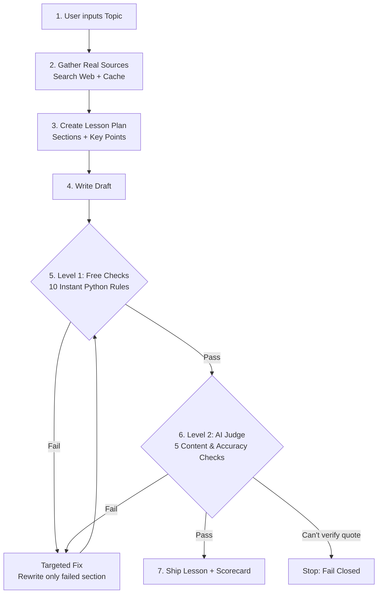

# 🎓 Vidya Loop: Self-Evaluating Lesson Generator

> **Most AI generators ship their very first draft — even when it is full of mistakes.**  
> **Vidya Loop does not.** It writes a lesson, tests it against **15 strict pass/fail rules**, fixes only what broke, and ships only when it is truly ready for a student.

---

## 💡 What is Vidya Loop?

**Vidya Loop** is an agentic AI system that generates beginner-friendly lessons for students starting from zero.

Our target student is a **12th-grade graduate from India** with basic English vocabulary and a non-English-medium background. If a lesson uses heavy jargon or 30-word sentences, the student gets lost.

Instead of hoping the AI gets it right in one try, Vidya Loop runs a continuous **Write → Check → Fix** loop:

1. **Finds real sources** from web search.
2. **Plans** the outline and key teaching points.
3. **Drafts** the lesson in simple words.
4. **Tests** the text against **15 strict rules** (10 free instant checks + 5 AI review checks).
5. **Fixes only the failed parts** (up to 2 retries).
6. **Ships** the final lesson along with a complete scorecard and rejection log.

---

## 🌟 See It in Action: A Simple Example

Here is what happens when you ask Vidya Loop to teach **"Introduction to RAG"**:

```
                       ┌─────────────────────────┐
                       │  Input: Topic & Learner │
                       │  "Introduction to RAG"  │
                       └────────────┬────────────┘
                                    │
                                    ▼
                       ┌─────────────────────────┐
                       │   Attempt 1: Draft      │
                       │ "RAG uses vector        │
                       │  embeddings to retrieve │
                       │  information..."        │
                       └────────────┬────────────┘
                                    │
                                    ▼
       ❌ FAILED (Rule 1: Sentence too long | Rule 6: Jargon not explained)
                                    │
                                    ▼
                       ┌─────────────────────────┐
                       │    Targeted Repair      │
                       │ Rewrites ONLY section 1 │
                       │ using a simple analogy  │
                       └────────────┬────────────┘
                                    │
                                    ▼
                       ┌─────────────────────────┐
                       │   Attempt 2: Revision   │
                       │ "RAG is like an open-   │
                       │  book exam. Instead of  │
                       │  memorizing everything, │
                       │  the AI looks up notes."│
                       └────────────┬────────────┘
                                    │
                                    ▼
            ✅ ALL 15 CHECKS PASS! Lesson ships to student.
```

### The Rejection Log (What the system records):

When a draft fails, the system creates an audit record before fixing it:

| What Happened | Details |
| :--- | :--- |
| **Where it failed** | Level 1: Free Rule Checks |
| **Failed rules** | `NATIVE_SENTENCE_LEN` (Sentence was 28 words) <br> `NATIVE_JARGON_DEFINED` (Used "vector embedding" without explaining it) |
| **What was changed** | Rewrote Section 1 only. Kept the rest of the draft. |
| **New sentence length** | Average 12 words per sentence (under 16-word limit). |
| **Analogies added** | Compared RAG to a student bringing reference notes into an exam room. |

---

## 🏗️ Architecture: How It Works

Vidya Loop is built on **LangGraph** as a reliable state machine. It follows 7 clear stages:



### The 7 Steps Explained

1. **Search Real Sources**: Pulls trusted articles from DuckDuckGo or Tavily. It freezes these sources so the AI cannot invent fake facts.
2. **Make a Plan**: Decides the exact sections and key ideas the student must learn before any writing starts.
3. **Write the First Draft**: A fast language model writes the lesson following the plan.
4. **Level 1: Free Checks (10 Python Rules)**:
   - Instant and costs **$0**.
   - Catches grammar, readability grade level, sentence length, missing sections, and unexplained jargon.
5. **Level 2: AI Judge (5 Smart Checks)**:
   - Runs only if Level 1 passes (saves API costs).
   - A separate model verifies factual accuracy, audience tone, and real-world examples.
   - **Must quote exact proof**: If the reviewer cannot quote an exact sentence from the source or lesson, its verdict is rejected.
6. **Surgical Self-Repair**:
   - If Section 2 has hard words but Sections 1, 3, and 4 are great, the system rewrites **only Section 2**.
   - Maximum 3 total attempts (1 first draft + 2 fixes) to prevent endless loops or runaway costs.
7. **Long-Term Memory**:
   - **Writing style mistakes** (like writing long sentences) are remembered for all future lessons.
   - **Topic mistakes** (like confusing a RAG detail) stay tied to that topic.
   - Approved lessons save simplified glossary terms for the next run.

---

## 📋 The 15 Quality Checks

Every lesson must score **15 out of 15** to ship.

### Level 1: Free Instant Checks (Cost: $0)
*These run in pure Python without calling an AI model.*

| # | Check Name | What It Checks |
| :---: | :--- | :--- |
| 1 | **Reading Ease** | Flesch reading score ≥ 60 (easy to read) and grade level ≤ 8.5. |
| 2 | **Sentence Length** | Average sentence ≤ 16 words. No single sentence over 25 words. |
| 3 | **Required Sections** | Every planned section heading is present and in order. |
| 4 | **Numbered Steps** | The process explanation contains at least 3 clear, numbered steps. |
| 5 | **Real Numbers in Examples** | The example contains at least 1 concrete number (e.g. "searches 500 pages"). |
| 6 | **Jargon Explained** | Any technical word from `jargon.yaml` is defined the first time it appears. |
| 7 | **No False Claims** | Known myths (e.g. "RAG retrains the model every time") are blocked immediately. |
| 8 | **Real Links Only** | Every website link cited must come from real retrieved sources. |
| 9 | **Real Sources Used** | Rejects offline fallback stubs so fake search data never passes. |
| 10 | **Simple Vocabulary** | Rare or difficult words must stay under 30% of total words. |

### Level 2: AI Review Checks (Cost: 1 Model Call)
*A smart model reviews meaning and pedagogy. All 5 are evaluated in one single prompt.*

| # | Check Name | What It Checks |
| :---: | :--- | :--- |
| 11 | **Factual Accuracy** | Every claim must match the search sources. No hallucinations. |
| 12 | **Audience Fit** | Uses friendly tone and relatable Indian everyday examples (e.g. local shops, train tickets, exams). |
| 13 | **Step-by-Step Example** | Includes a full story with an input, a process, and an output. |
| 14 | **Key Points Covered** | Every must-cover idea from the lesson plan is clearly taught. |
| 15 | **Smooth Flow** | Moves logically from introduction → explanation → practical takeaway. |

---

## ⚖️ Why Vidya Loop is Different

| Feature | Typical AI Writer | Vidya Loop |
| :--- | :--- | :--- |
| **Review process** | None. Ships the 1st draft. | 15 strict checks (10 free + 5 AI). |
| **Handling failures** | Ignores them or starts all over. | Rewrites only the failed section. |
| **Checking facts** | Trusts whatever the model says. | Checks exact quotes against verified web sources. |
| **Cost control** | Re-runs full prompts over and over. | Free checks run first; max 3 total attempts. |
| **Safety guard** | Guesses when unsure. | **Fails closed**: If a checker cannot prove its verdict, it stops instead of shipping bad content. |

---

## 🚀 Quickstart: Get Started in 3 Minutes

### 1. Clone & Install

```bash
# Clone the repository
git clone https://github.com/okyashgajjar/vidya-loop.git
cd vidya-loop

# Create and activate a virtual environment
python3 -m venv .venv
source .venv/bin/activate    # On Windows: .\.venv\Scripts\Activate.ps1

# Install dependencies
pip install -r requirements.txt
```

### 2. Configure API Keys

Copy the sample environment file:
```bash
cp .env.example .env
```

Open `.env` and add your API keys:
```env
LLM_PROVIDER=nvidia
NVIDIA_API_KEY=your_key_here
DRAFT_MODEL=meta/llama-3.3-70b-instruct
JUDGE_MODEL=meta/llama-3.3-70b-instruct
```
*(You can use NVIDIA NIM, OpenRouter, OpenAI, or any OpenAI-compatible provider).*

### 3. Run the App

#### Option A: Web Interface (Streamlit)
```bash
streamlit run app.py
```
Open your browser at `http://localhost:8501`. Enter a topic like `"Introduction to RAG"` and watch the agent plan, draft, verify, and fix the lesson in real time.

#### Option B: Terminal Command (CLI)
```bash
python scripts/run_lesson.py "Introduction to RAG"
```

---

## 🧪 Try Deliberate Error Tests

Want to test how Vidya Loop catches and fixes mistakes? Use the built-in error injection flags:

```bash
# Test 1: Injects an undefined jargon word and a false claim
# Caught immediately by Free Level 1 checks ($0 spent on AI reviewer)
python scripts/run_lesson.py "Introduction to RAG" --inject-error factual_jargon

# Test 2: Injects a cleverly reworded false claim
# Bypasses simple string match, caught by Level 2 AI Judge with source proof
python scripts/run_lesson.py "Introduction to RAG" --inject-error paraphrased_falsehood
```

---

## 🗂️ Project Structure

```
├── app.py                  # Streamlit web user interface
├── src/
│   ├── graph.py            # LangGraph state machine & retry logic
│   ├── schemas.py          # Data models (Plan, Draft, Checks, Log)
│   ├── db.py               # PostgreSQL & local JSON fallback storage
│   ├── memory.py           # Long-term style and topic memory
│   ├── nodes/
│   │   ├── search.py       # DuckDuckGo & Tavily source retrieval
│   │   ├── plan.py         # Lesson outline and key points generator
│   │   ├── generate.py     # Draft writer & surgical section repair
│   │   ├── eval_native.py  # 10 free instant rule checks
│   │   └── eval_judge.py   # 5 AI judge checks with quote validation
├── prompts/                # System prompts (plan.md, generate.md, judge.md)
├── rubric.yaml             # Pass/fail rule definitions and thresholds
├── jargon.yaml             # List of technical terms requiring definitions
├── scripts/
│   ├── run_lesson.py       # CLI lesson generator
│   └── healthcheck.py      # System and API verification script
└── tests/                  # 66 automated tests (100% mocked, no API cost)
```

---

## 🛠️ Tech Stack

- **Workflow Engine:** [LangGraph](https://github.com/langchain-ai/langgraph) (Clear state transitions, retries, and boundaries)
- **Data Validation:** [Pydantic v2](https://docs.pydantic.dev/) (Strict type enforcement across all nodes)
- **Web Interface:** [Streamlit](https://streamlit.io/) (Interactive dashboard, live logs, scorecards)
- **Language Analysis:** [textstat](https://github.com/textstat/textstat) (Deterministic readability scores & sentence length)
- **Search Retrieval:** DuckDuckGo Search & [Tavily](https://tavily.com/)
- **Storage:** PostgreSQL + `pgvector` (with automatic, zero-config local JSON fallback)

---

## 🤝 Summary

> **Good educational content isn't luck — it is engineering.**  
> Vidya Loop turns lesson creation into a reliable manufacturing line: verify early, fix surgically, demand proof, and never ship an unverified first draft.
