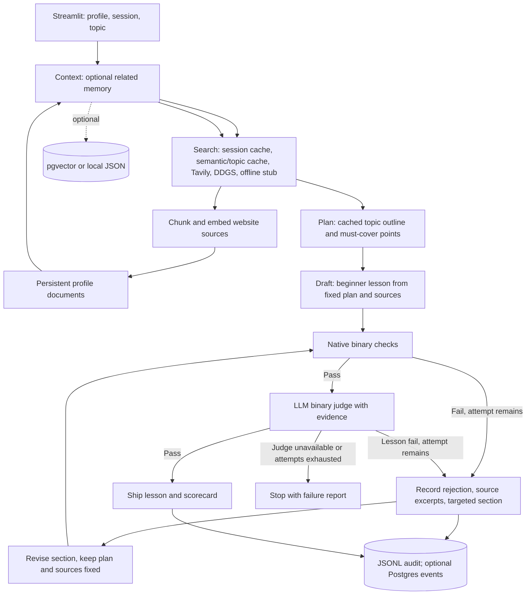

# Current pipeline architecture

## State boundaries

- `source_pack` and `plan` are set before the first draft and remain fixed during retries.
- `attempt` is one-based. `MAX_ATTEMPTS` includes the initial attempt.
- `revision_source_content`, `revision_sections`, and `rejection_log` carry only the feedback required for a targeted revision.
- `semantic_context` is optional prompt context. It never changes a native result or judge result.
- `final_status` distinguishes passed lessons from rejected lessons and evaluator failures.

## Quality gates

Native checks run first and use fixed rubric configuration for readability, sentence length, required plan sections, ordered process steps, first-use jargon definitions, citation integrity, and configured false claims. A native failure skips the LLM judge for that attempt.

The judge checks accuracy and grounding, audience fit, practical example, every planned must-cover point, and flow. The prompt asks the judge to name missing points. Any omitted judge check is a conservative failure marked as an evaluator error; the router stops instead of treating it as lesson feedback.

## Provider requests and retries

The provider wrapper uses model IDs from `.env`. It logs each API attempt and counts reasoning tokens when the provider reports them. Stream chunks with no choices are ignored. A streamed draft is accepted only when its final finish reason is `stop`. Truncated or incomplete streams are discarded, the UI buffer is reset, and a non-streaming fallback uses the same token and reasoning settings. A completed fallback may be evaluated; another truncated response goes through the bounded provider retry and then fails visibly.

The draft and judge may share a model if the environment configures them that way. The UI and JSONL run log warn because that weakens review independence.

## Persistence and fallback

Profiles and failure counters use profile-scoped JSON files. Session messages, run records, feedback artifacts, embeddings, and optional semantic data are dual-written to the local JSON store as a Postgres fallback. Run events are also appended to a per-run JSONL file. pgvector is an optimization for semantic lookup, not a requirement for generation or evaluation.

Each session persists the latest lesson-run status. A passed run also stores its shipped lesson and frozen source pack, so follow-up chat remains available after an app restart. A newer failed or in-progress run replaces that artifact and blocks stale follow-ups.

Related context uses cosine similarity and `SEMANTIC_SIMILARITY_THRESHOLD`. At most ten glossary records and three failure notes are injected. `LLM_TOP_P` only controls model sampling. If embedding generation fails or exceeds its budget, the graph logs a skipped context result and continues without semantic context.

The Persistent Knowledge Library chunks uploaded TXT, Markdown, HTML, and PDF files. It stores profile-scoped vectors in `knowledge_chunks`, with the same JSON fallback as the rest of local persistence. Search results are also chunked and added to that library. Each run retrieves only above-threshold chunks, then freezes them into its source pack for plan, draft, evaluation, and follow-up. The flow is: documents and websites → overlapping chunks → embeddings → similarity retrieval → source-enriched lesson context → model answer. Upload traces record metadata and counts, not document text.

## Follow-up path

Follow-up chat checks the current session's latest run and only answers if it passed. It uses the shipped lesson and the source pack retained in that session. It does not rerun search, planning, or evaluation. One initial answer call is allowed; failed native readability or sentence-length checks permit one simplification call.

## Deliberate-error path

The demo injection adds a known false RAG claim and an unexplained jargon term after first-draft generation. Native checks detect the configured false claim and the first-use jargon violation. The rejection event records the source excerpts, selected process section, and a unified diff after revision. The injected text is not added to later attempts.
